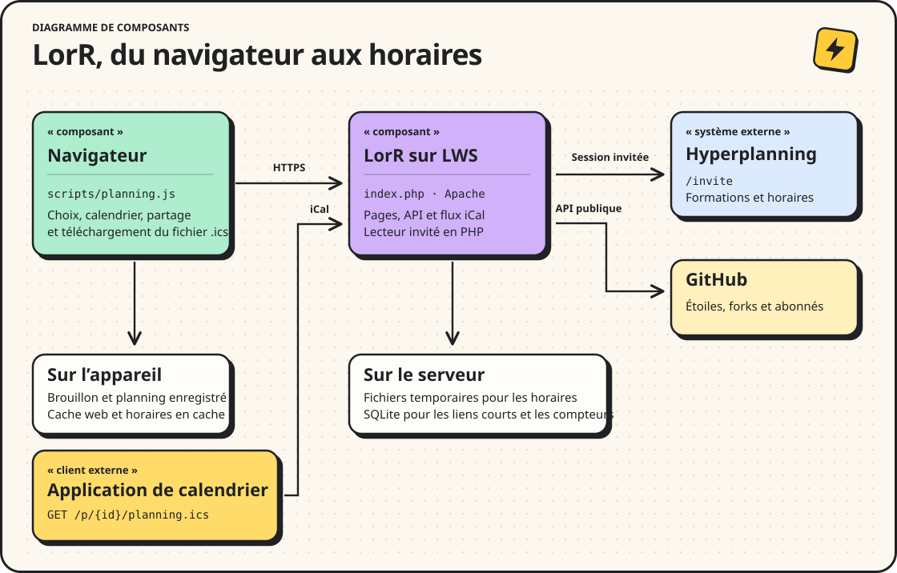
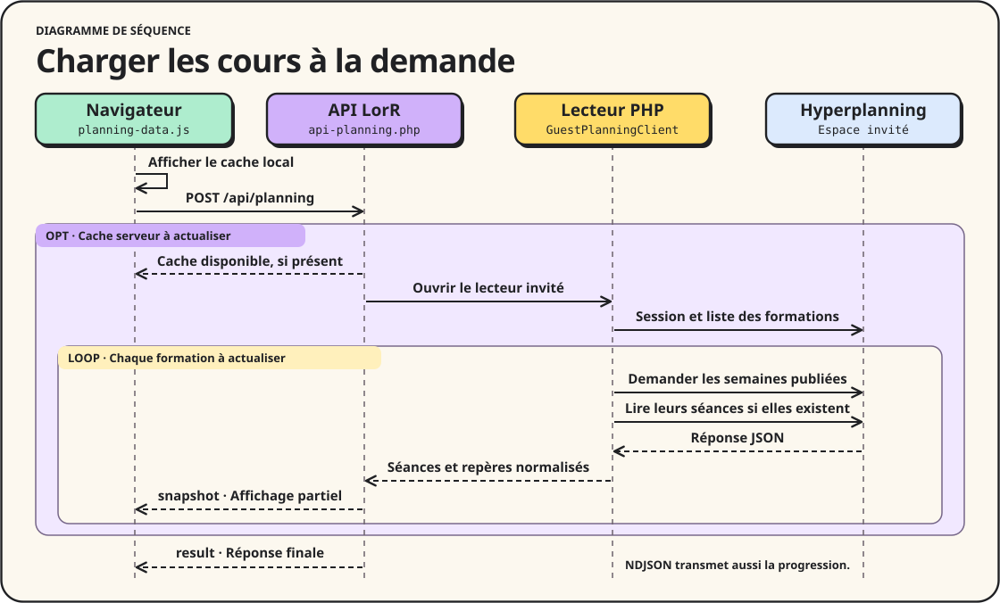
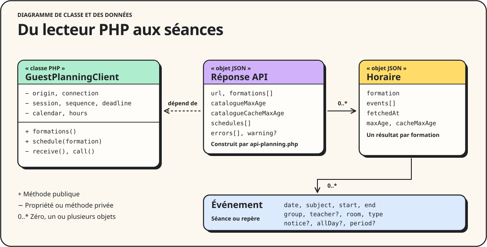

# Comment fonctionne LorR

LorR transforme les horaires publiés dans un espace invité Hyperplanning en
un planning personnel. PHP récupère les horaires des formations choisies.
Le navigateur applique la sélection des cours et construit les vues mois,
semaine et liste. Un lien partagé décrit la sélection et permet de la
recharger. Pour installer ou déployer le projet, consulte le [README](README.md).

## Sommaire

1. [Architecture et routes](#1-architecture-et-routes)
2. [Parcours et état du navigateur](#2-parcours-et-état-du-navigateur)
3. [Requêtes, progression et caches](#3-requêtes-progression-et-caches)
4. [Lecteur Hyperplanning et modèle des horaires](#4-lecteur-hyperplanning-et-modèle-des-horaires)
5. [Cours, groupes et doublons](#5-cours-groupes-et-doublons)
6. [Vues du calendrier et export ICS](#6-vues-du-calendrier-et-export-ics)
7. [Enregistrement et liens de partage](#7-enregistrement-et-liens-de-partage)
8. [Statistiques et page Soutenir](#8-statistiques-et-page-soutenir)
9. [Application web, animation et référencement](#9-application-web-animation-et-référencement)
10. [Points de contrôle et repères de maintenance](#10-points-de-contrôle-et-repères-de-maintenance)

## 1. Architecture et routes



Les flèches indiquent quel composant lance la requête ou utilise un stockage.
Sur LWS, Apache sert les ressources statiques et remet les autres chemins
au routeur PHP. L’interface utilise du JavaScript natif sans étape de
compilation. Le lecteur Node.js avec Chromium reste disponible sur les
installations qui le configurent.

Les premières versions suivies dans Git utilisaient des pages HTML, du
JavaScript et des fichiers ICS archivés. Le créateur a d’abord obtenu ses
horaires avec un lecteur Chromium piloté par PHP. Les anciennes adresses
HTML ont ensuite laissé place au routeur `index.php`. Le lecteur invité
en PHP a permis de déployer la lecture en direct sur LWS sans Node.js.

| Fichier | Rôle à l’exécution |
| --- | --- |
| [`.htaccess`](.htaccess) | Laisse passer le défi ACME. Redirige HTTP vers HTTPS sur le domaine de production. Bloque l’accès HTTP à certains fichiers et répertoires internes. Sert les ressources statiques prévues. Transmet les autres chemins à `index.php` avec `LORR_ROUTE`. |
| [`index.php`](index.php) | Détermine le chemin demandé et la base de l’installation. En local, laisse le serveur PHP intégré servir les ressources statiques prévues. Charge la vue ou le traitement de l’API. |
| [`views/`](views/) | Contient le HTML des pages et les éléments communs. Les noms de champs, identifiants et attributs `data-*` relient le HTML aux scripts. |
| [`scripts/`](scripts/) | Contient l’état du créateur, l’accès à l’API, le rendu des horaires, le partage et l’export. |
| [`server/`](server/) | Contient le lecteur invité, la validation des liens, le stockage et les statistiques. |
| [`styles/planning.css`](styles/planning.css) | Définit l’identité visuelle de LorR, les panneaux, les étapes, les grilles et les styles des dialogues. |

Le routeur utilise `REDIRECT_LORR_ROUTE` ou `LORR_ROUTE` lorsqu’Apache les
transmet. Sinon, il lit le chemin de `REQUEST_URI`. Il retire le préfixe
de l’installation si celle-ci se trouve dans un sous-dossier.

| Route | Traitement |
| --- | --- |
| `/` | `views/home.php` et reprise d’un planning depuis le navigateur |
| `/planning` | `views/planning.php` et configuration publique des domaines autorisés |
| `/stats` | `siteUsage()` dans `server/usage.php`, puis `views/stats.php` |
| `/soutenir` | `views/soutenir.php`, puis chargement des chiffres GitHub en JavaScript |
| `/p/{id}` | Recherche de l’identifiant dans SQLite et ouverture du planning correspondant |
| `POST /api/planning` | Lecture du catalogue et des horaires |
| `POST /api/planning/links` | Création d’un identifiant court pour une sélection |
| `POST /api/stats/course-clicks` | Ajout d’un lot de clics au compteur |
| `GET /api/stats/github` | Lecture des chiffres publics du dépôt |
| `/manifest.webmanifest`, `/robots.txt`, `/sitemap.xml` | Configuration de l’application et informations d’indexation |

Des anciennes adresses comme `/planning.html` redirigent en `308` vers la
route actuelle en conservant la chaîne de requête. `/idees` redirige en
`302` vers `/soutenir` pour `GET` et `HEAD`. Un chemin inconnu reçoit un
`404` avec `Cache-Control: no-store`.

## 2. Parcours et état du navigateur

[`views/planning.php`](views/planning.php) fournit les quatre panneaux et
les dialogues. Son bloc JSON `planning-source-config` transmet le modèle
des domaines HEH, les domaines ajoutés par l’administrateur et les limites
de requête. Les scripts différés s’exécutent dans l’ordre du HTML.
[`planning.js`](scripts/planning.js) se charge en dernier.

| Étape | Action et effet dans le code |
| --- | --- |
| **Lien** | Le formulaire passe le lien à `fetchPlanning()`. Une demande sans formation sert à charger le catalogue. Si la source est déjà présente, le formulaire rouvre ses formations. |
| **Formations** | `renderFormations()` affiche les catalogues par source et applique la recherche. Chaque choix est associé au couple URL et formation. Le bouton suivant appelle `openCourseSelection()`. |
| **Cours** | `loadSchedule()` prépare les horaires des formations. `renderCourses()` sépare les cours et les repères. Les filtres de groupe et de matière modifient la liste visible. |
| **Planning** | `goToStep(4)` marque le planning comme créé. `renderDays()` filtre les événements, fusionne les doublons et transmet le résultat au calendrier. |

`stepAvailable()` vérifie les prérequis des étapes. L’étape Planning
nécessite un jeu d’horaires associé à la sélection de formations actuelle
et au moins une séance du cours choisi. `showStep()` affiche un panneau,
met à jour `aria-current` et peut déplacer le focus vers la nouvelle étape.

| État en mémoire | Contenu |
| --- | --- |
| `sources` | `Map` de l’URL invitée vers sa liste de formations |
| `selections` | `Map` des formations cochées, indexées par `selectionKey(url, formation)` |
| `selectedCourses` | `Set` des clés de cours cochées |
| `selectedCourseGroups` et `showAllCourseGroups` | Préférences du filtre de groupes |
| `hiddenNotices` | `Set` des repères décochés |
| `events` | Horaires récupérés avec la source, la formation et l’horodatage ajoutés par `mergeSchedules()` |
| `loadedFormations` et `failedFormations` | Signature triée des formations chargées et liste des formations à réessayer |
| `activeRequest` et `scheduleRequest` | Contrôleur de la requête active et référence au chargement des cours |

`saveChoices()` sérialise le brouillon dans `localStorage` sous la clé
`lorr-hyperplanning`. `loadLocalChoices()` recrée les `Map` et les `Set`
ou initialise un état vide. Le code accepte aussi l’ancien format qui
stockait les cours masqués. `loadSchedule()` transforme ce choix en
liste de cours cochés après récupération des événements.

## 3. Requêtes, progression et caches



Les lignes verticales représentent les participants. Le temps descend.
Les flèches pleines représentent les appels et les flèches en pointillé
les retours. Le cadre **OPT** s’applique seulement si PHP doit actualiser
son cache. Le cadre **LOOP** se répète pour les formations à actualiser.
Si le cache du navigateur suffit, le parcours s’arrête avant le `POST`.

### Du navigateur à PHP

1. `loadSchedule()` rassemble les formations par URL invitée. Il lit
   les caches des sources en parallèle, puis traite les demandes réseau
   source par source. Le bouton de reprise cible les formations en échec.
2. `fetchPlanning()` valide et normalise le lien, déduplique les noms et
   repère les horaires expirés ou manquants. Si le catalogue et les
   horaires demandés sont récents, il renvoie le cache du navigateur.
3. `requestPlanning()` relie l’annulation de l’interface à la requête
   réseau et fixe une limite de 120 secondes.
4. `streamPlanning()` envoie `{url, formations}` en JSON et demande
   `application/x-ndjson`. Une réponse NDJSON contient un objet JSON
   par ligne. Le script conserve la fin incomplète d’un fragment réseau
   jusqu’au fragment suivant. Il sait aussi lire une réponse JSON entière.
5. `mergeSchedules()` remplace les événements de la formation reçue.
   Les autres formations déjà affichées restent visibles. Un résultat
   partiel peut donc rendre des cours accessibles avant la fin de la lecture.

[`api-planning.php`](api-planning.php) accepte `POST` et `application/json`.
Il lit au plus 32 Kio de JSON utile, contrôle une liste de 100 formations
distinctes maximum et accepte l’ancien champ singulier `formation`.
Le format ancien renvoie une propriété `events` à plat. La réponse
actuelle utilise `schedules[]` et associe les erreurs à une formation.
Le serveur utilise `sendUpdate()` pour vider les tampons PHP quand il
envoie le flux. L’hébergeur peut avoir ses propres tampons.

| Message NDJSON | Effet dans le navigateur |
| --- | --- |
| `progress` | Affiche le message et calcule l’avancement avec `done / total`. |
| `snapshot` | Fusionne un résultat partiel, y compris une réponse issue du cache. |
| `result` | Contient le résultat complet de la demande et les erreurs par formation. |
| `error` | Interrompt la lecture du flux avec le message reçu. |
| `heartbeat` | Le lecteur Chromium peut produire cette ligne. PHP l’utilise pour détecter une déconnexion. Le navigateur l’ignore. |

`updateLoading()` affiche un pourcentage qui progresse par paliers réels.
Après 2 800 ms sans nouveau palier, il retire la valeur de `<progress>`.
Le CSS anime alors la barre en mode indéterminé et l’interface affiche
« En cours ». Cette animation ne mesure pas le temps restant.
`startRequest()` annule la demande précédente. Un clic normal dans la
navigation ou un `pagehide` annule aussi le chargement. Le navigateur
peut ainsi retourner à l’accueil immédiatement.

### Les différents caches

| Emplacement | Clé et contenu | Règle de lecture |
| --- | --- | --- |
| Navigateur, cache `lorr-planning-horaires-v1` | URL invitée pour le catalogue. Couple URL et formation pour chaque horaire. `sessionStorage` sert de repli si Cache Storage est indisponible. | `expires` détermine la fraîcheur. `keepUntil` limite la réutilisation. Les durées transmises par PHP servent à calculer ces dates. |
| PHP, dossier temporaire `lorr-hyperplanning-v3` | Fichier JSON nommé à partir d’une empreinte SHA-256 de l’URL et, pour un horaire, du nom de la formation. Une entrée contient `time` et `data`. | Catalogue récent 15 min. Horaire récent 2 min. Lecture de secours jusqu’à 7 jours après récupération. |
| Navigateur, cache du service worker | HTML et ressources de l’application. Voir la section 9. | Le service worker essaie le réseau avant son cache. |

Le serveur envoie les données disponibles avant d’actualiser les entrées
expirées. Il écrit chaque nouvel horaire dans un fichier temporaire,
puis le renomme vers le fichier de cache. `rememberPlanningResult()`
évite d’écraser dans le navigateur un horaire plus récent avec un résultat
plus ancien. Si Hyperplanning échoue, les formations disponibles restent
affichées. Une erreur distingue celles dont LorR a gardé un horaire et
celles sans donnée. Les sept jours limitent la lecture du cache PHP.
L’expiration ne supprime pas à elle seule les fichiers du serveur.

## 4. Lecteur Hyperplanning et modèle des horaires



`GuestPlanningClient` est la classe PHP du lecteur. Les autres boîtes
décrivent les structures de données de l’API. `0..*` signifie que le
tableau peut être vide ou contenir plusieurs éléments.

| Bloc de [`guest-planning.php`](server/guest-planning.php) | Rôle |
| --- | --- |
| `__construct()` | Revalide l’URL, prépare cURL, ouvre `/invite`, lit les paramètres d’ouverture et initialise une session invitée. Charge le calendrier de l’établissement et la table de ses créneaux horaires. |
| `receive()` | Envoie les requêtes HTTPS au même espace invité. Garde les cookies de session en mémoire. Limite la connexion à 3,5 s et chaque requête à 12 s, dans le budget global de 80 s du lecteur. Coupe une réponse si elle dépasse 6 Mio. |
| `sequenceCode()` et `call()` | Préparent le numéro attendu par le protocole invité. Transmettent la demande JSON et vérifient que la réponse correspond à la session et à l’appel en cours. |
| `formations()` | Extrait du catalogue le libellé et la référence interne de chaque formation publiée. |
| `schedule()` | Lit les semaines publiées pour une formation. Demande les séances pour ces semaines si la période contient des semaines. |
| `guestPlanningDomain()` | Convertit une suite comme `[1,3..5]` en numéros triés `[1,3,4,5]`. Vérifie les bornes et élimine les doublons. |
| `guestPlanningLabels()` et `guestPlanningTime()` | Préparent les libellés publiés et ramènent les heures au format `HH:MM`. |
| `guestPlanningEvents()` | Transforme les créneaux bruts en séances et les périodes fériées en repères du calendrier. |
| `readGuestPlanning()` | Coordonne la lecture. Appelle `$report` pour la progression et `$publish` pour livrer chaque formation disponible. Une formation en échec est ajoutée à `errors`. |

La position d’une séance contient le jour ouvré et son créneau. La division
entière par le nombre de créneaux par jour donne l’index du jour ouvré.
Le reste donne l’index de la première heure. La durée indique quel créneau
fournit l’heure de fin. Le premier lundi de l’année, le numéro de semaine
et le jour ouvré donnent la date. Le lecteur ignore les lignes dont la
position, la durée, la semaine, les heures ou le libellé sont inutilisables.

Une séance renvoie notamment `date`, `start`, `end`, `subject`, `group`,
`teacher`, `room` et `type`. Un repère contient `notice`, `allDay: true`
et `period: [début, fin]` avec une date de fin incluse. Une semaine fériée
devient un repère `pause` du lundi au dernier jour ouvré. Un jour férié
individuel devient un repère `holiday` s’il est ouvré, fait partie des
semaines publiées et se trouve hors des semaines fériées déjà représentées.

Cet accès est une extraction automatisée des données de l’espace invité
public. PHP lit les paramètres de démarrage dans la page HTML, puis
obtient les horaires via les réponses JSON des appels internes. Si ce
format change, il faut adapter le lecteur. [Documentation de l’espace Invités](https://doc.index-education.com/fr/hyperplanning/hyperplanning/HYPERPLANNING/E/Espace_Invit%C3%A9s.htm)

Sur une installation qui fournit [`server/read.cjs`](server/read.cjs),
PHP peut lancer le lecteur Chromium après l’échec de la lecture PHP.
Ce lecteur utilise Playwright pour ouvrir l’espace invité, sélectionner
la vue liste et lire les séances affichées. Il limite la navigation à
l’origine invitée et ignore les images, les polices et les vidéos. Si une
lecture complète des séances échoue avec une liste incomplète, le lecteur
peut relire les semaines par blocs de quatre. Le processus transmet ses
messages à PHP sur sa sortie standard et ferme Chromium à la fin.

Pour activer ce lecteur sur un autre hébergement, installe Node.js 20
ou plus récent, lance `npm ci` et `npm run install:browser`, puis autorise
`proc_open` dans PHP. `LORR_CHROMIUM_PATH` permet d’indiquer le chemin
d’un navigateur Chromium déjà installé.

Voici un exemple fictif de résultat par formation. `fetchedAt` indique
le moment où LorR a récupéré l’horaire. `maxAge` et `cacheMaxAge` donnent
les durées restantes en secondes au moment de la réponse.

```json
{
  "formation": "Informatique · Exemple",
  "fetchedAt": 1796025600,
  "maxAge": 120,
  "cacheMaxAge": 604800,
  "events": [
    {
      "date": "2026-12-01",
      "start": "10:15",
      "end": "11:45",
      "subject": "Réseaux",
      "group": "Groupe A",
      "teacher": "",
      "room": "B12",
      "type": "TP"
    }
  ]
}
```

Quand le navigateur reçoit cet horaire, `mergeSchedules()` recopie
`formation`, `fetchedAt` et l’URL de la source dans chaque événement.
La même séance peut alors servir à la sélection du cours, au rendu de
l’agenda ou à l’export ICS.

## 5. Cours, groupes et doublons

Un **cours** est une option à cocher. Une **séance** est une occurrence
datée de ce cours. Un **repère** décrit un jour férié ou une période
particulière. [`planning-choices.js`](scripts/planning-choices.js) prépare
ces données pour les listes et le calendrier.

1. `choiceText()` retire les accents, uniformise les espaces et passe
   le texte en minuscules pour la recherche et certaines comparaisons.
2. `courseKey()` identifie un cours par URL, formation, groupe, matière
   et type. `courseOptions()` réunit les séances de chaque clé. Si deux
   options ont exactement le même ensemble de séances, LorR affiche une
   option et lui associe les clés des deux options.
3. `renderCourseGroups()` construit les choix de groupe par formation.
   Il considère comme communs les cours sans groupe distinct et ceux
   des formations qui n’ont qu’un groupe repéré. `renderCourseList()`
   conserve aussi les cours cochés à l’écran pendant le filtrage.
4. La recherche exige que chaque mot saisi figure dans le texte normalisé.
   Les variantes d’une matière sont regroupées dans un élément `<details>`.
   Cocher tout agit sur les options affichées. Le mode **Ma sélection**
   limite l’affichage aux cours cochés.
5. Les repères sont cochés par défaut. Les repères décochés sont mémorisés
   dans `hiddenNotices`, selon la source, le type, le libellé et la période.

`selectedPlanningEvents()` filtre les événements avant l’affichage
et l’export. Pour identifier un doublon de séance, `sessionKey()` compare
la source, la date, les heures et la matière, puis le groupe, la salle,
l’enseignant et le type. Pour un repère, le type de repère remplace ces
quatre champs. `uniqueSessions()` affiche un seul événement par clé
et conserve la liste des formations qui l’ont fourni. Les périodes
couvrant plusieurs jours sont dépliées pour les grilles. `groupNoticePeriods()`
réunit ensuite les repères consécutifs qui ont la même source, le même type,
le même libellé et les mêmes formations.

## 6. Vues du calendrier et export ICS

[`calendar-view.js`](scripts/calendar-view.js) reçoit les séances déjà
filtrées et triées dans `createPlanningView().show()`. Il les indexe
par date. Il recalcule l’échelle horaire du planning et prépare les
sélecteurs. La préférence `lorr-calendar-view` garde le dernier mode
choisi. Au premier affichage, la vue **Mois** est sélectionnée.

| Vue | Règles de rendu |
| --- | --- |
| **Mois** | `renderMonth()` dessine toujours 42 cases, en commençant au lundi de la première semaine visible. Chaque case peut afficher deux événements. Le bouton `+N séances` ouvre le dialogue de la journée. Les jours hors mois sont atténués. |
| **Semaine** | `layoutDay()` convertit les heures en minutes. Les séances forment des blocs de hauteur proportionnelle à leur durée. Les séances simultanées utilisent des colonnes distinctes. `renderWeekNotices()` place les repères sur un bandeau au-dessus des heures. |
| **Liste** | `renderList()` groupe les entrées sous le lundi de leur semaine. Il affiche les périodes fériées comme des plages de dates. |

En semaine, l’algorithme trie les créneaux par heure de début, puis
place chaque créneau dans la première colonne libérée. Les créneaux
liés par un chevauchement partagent une largeur calculée à partir du
nombre de colonnes du groupe. `updateWeekScale()` parcourt toutes les
dates chargées. Il part de 8 h à 18 h et élargit la plage si nécessaire.
Le mois et la semaine utilisent la même hauteur de vue pour le planning
chargé. Les sélecteurs et les flèches changent de période dans la plage
du planning, qui inclut la date du jour.

`showDay()` ouvre le dialogue d’une date. `showSession()` affiche
les champs renseignés d’une séance, avec une liste triée lorsqu’elle
concerne plusieurs formations. Un clic sur une séance déclenche le
compteur de clics. Les repères ne déclenchent pas ce compteur.
`applyCourseColor()` calcule une teinte pastel à partir de la clé de
cours ou de repère.

`renderScheduleFreshness()` affiche l’heure de récupération en heure
de Bruxelles. Si les formations proviennent de lectures différentes, il
affiche la plus ancienne. Si un événement sélectionné a un horodatage
invalide ou absent, il masque l’indication.

### Export ICS

[`calendar-export.js`](scripts/calendar-export.js) génère un événement
`VEVENT` pour chaque séance sélectionnée et pour chaque repère retenu
après regroupement. `calendarTimestamp()` interprète les heures en
`Europe/Brussels` avant de les convertir en UTC. Un événement sur la
journée entière utilise des dates simples. Sa date de fin ICS est
exclusive, donc LorR écrit le lendemain du dernier jour du repère.

`calendarUid()` produit un identifiant déterministe à partir de la
séance. `calendarText()` échappe les séparateurs et les sauts de ligne.
`foldCalendarLine()` coupe les lignes longues à 75 octets sans couper
un caractère UTF-8 au milieu. `planning.js` crée un `Blob` et déclenche
le téléchargement de `planning-lorr.ics`. Le fichier représente le
planning visible au moment de l’export. Le README rappelle comment
vérifier les horaires à jour.

## 7. Enregistrement et liens de partage

**Enregistrer** garde le fragment du planning sous la clé
`lorr-saved-planning` dans `localStorage`. [`home.js`](scripts/home.js)
affiche le lien de reprise sur l’accueil. Le brouillon utilise une
autre clé. Une personne qui ouvre un lien partagé récupère la sélection
incluse dans ce lien.

### Construire le lien

1. `planningShareState()` produit le format `[1, formations, cours, exclusions?]`.
   Chaque formation contient l’hôte et son nom. Chaque cours référence
   une formation par son index et contient le groupe, la matière et le type.
2. `packPlanningState()` essaie une version plus compacte, `[2, sources]`.
   Elle range les cours sous leur source, leur formation et leur couple
   groupe et type. Elle remplace les domaines annuels HEH par l’année.
3. `encodePlanningCode()` choisit le plus petit résultat parmi les formats
   disponibles. Le préfixe `b.` indique le JSON en UTF-8 encodé en Base64URL.
   Le préfixe `z.` indique le même encodage après compression Deflate.
   Le lien autonome devient `/planning#p=…`. Il contient les choix.
4. `shortPlanningLink()` tente de créer un lien de 12 caractères en envoyant
   le code à `/api/planning/links`. Après 4 secondes ou en cas d’échec,
   le bouton utilise le lien autonome. Si le presse-papiers est indisponible,
   un champ permet de copier l’adresse manuellement.

[`planning-links.php`](server/planning-links.php) vérifie le préfixe,
l’encodage et les structures reçues. Un code stocké peut faire au
maximum 4 096 caractères. Les données décompressées sont limitées
à 256 Kio. Les formats valides peuvent référencer au plus 32 sources,
avec un maximum de 100 formations par source.

`planningLinkId()` calcule une empreinte SHA-256 du code, encode
l’empreinte en Base64URL et garde les 12 premiers caractères. Le
serveur peut ainsi retrouver le même identifiant pour le même code.
`storePlanningLink()` limite l’écriture à 512 liens par premier
caractère. Après insertion, il relit le code pour vérifier la
correspondance. La table `planning_links` contient `id` et `code`.

### Ouvrir le lien

1. Avec le lien court `/p/{id}`, PHP lit le code dans SQLite et vérifie
   que son empreinte correspond à l’identifiant. Le serveur envoie
   [`views/shared-planning.php`](views/shared-planning.php), une page
   `noindex` qui fournit aussi un lien à suivre manuellement.
2. [`shared-planning.js`](scripts/shared-planning.js) ouvre
   `/planning#p=…` avec `location.replace()`. Un lien autonome arrive
   directement à cette adresse.
3. `restorePlanning()` lit le fragment, décode et vérifie les choix.
   Le navigateur accepte aussi l’ancien fragment `#planning=…`.
   Le suivi des révisions empêche une lecture ou un encodage asynchrone
   devenu obsolète d’écraser une sélection plus récente.
4. `keepPlanningInHistory()` place le fragment dans `history.state` et
   affiche une adresse propre. `loadSchedule()` récupère les événements
   actuels pour les formations restaurées et applique leurs cours cochés.

Le code partage les choix sans chiffrer leur contenu. Toute personne
qui possède le lien peut retrouver ces choix. La version courte dépend
de la base SQLite du serveur. La version autonome dépend du format
de lien pris en charge par le navigateur et par LorR.

## 8. Statistiques et page Soutenir

[`server/usage.php`](server/usage.php) agrège les compteurs en heure de
Bruxelles. [`views/stats.php`](views/stats.php) affiche le total et les
sept derniers jours. Les boutons d’information décrivent les unités.
[`stats-chart.js`](scripts/stats-chart.js) lit les mêmes valeurs que le
tableau pour tracer une courbe par compteur. Les cases de la légende
filtrent les courbes et l’axe vertical s’adapte aux courbes affichées.
Le graphique horaire utilise les relevés des mêmes sept jours. Les deux
graphiques partagent la légende et ajustent leur échelle verticale
indépendamment. PHP fournit les créneaux horaires dans la page. Le
navigateur les réutilise dans le tableau quand le lecteur change le jour.
Le paramètre `heure=AAAA-MM-JJ` présélectionne le jour du tableau.
Les relevés utilisent des clés UTC pour séparer les deux occurrences d’une
heure au passage à l’heure d’hiver. La page affiche les créneaux en heure
de Bruxelles jusqu’à l’heure en cours. La zone grisée et les tirets
représentent les heures sans historique. Un zéro indique un créneau suivi
sans événement pour ce compteur.

| Mesure | Moment et unité |
| --- | --- |
| Accueil et créateur | Un chargement `GET` reçu par PHP. Les demandes de préchargement du service worker sont exclues. |
| Demandes d’horaires | Une demande avec des formations reçue par `/api/planning`, même si PHP sert son cache. |
| Cours chargés | Une combinaison matière, groupe et type par formation et par réponse. |
| Séances chargées | Chaque séance renvoyée pour chaque formation, hors repères. |
| Cours différents | Une matière par URL invitée, comptée une fois au total, par jour et par heure où elle est chargée. |
| Liens invités distincts | Une URL invitée, comptée une fois au total, par jour et par heure où un catalogue est disponible dans la réponse. |
| Clics sur des cours | Nombre d’ouvertures de détails de séance déclaré par le navigateur. |

`recordCourseClick()` cumule au plus 100 clics par envoi et déclenche
un premier envoi programmé après 2,5 s. Un départ de page ou un onglet
masqué vide aussi le lot. [`course-clicks.php`](server/course-clicks.php)
vérifie la méthode, le type JSON et le nombre reçu avant de répondre
`204`. La requête transmet un compteur. Les statistiques d’usage
stockent les totaux, les dates et les empreintes des sources et
des matières distinctes.

[`storage.php`](server/storage.php) ouvre `LORR_STATS_DIR` ou `var/`
et détecte SQLite. `usage_counts` mémorise les compteurs par jour et
par mesure. `usage_sources` et `usage_courses` dédupliquent par
jour ou par heure et par empreinte. La valeur `total` sert aux agrégats
historiques. Chaque écriture ajoute le créneau horaire dans la même
transaction ou sous le même verrou JSON que les compteurs existants.
Les écritures SQLite utilisent une transaction. En mode JSON,
un verrou protège la lecture et l’écriture. Si SQLite est installé
après le mode JSON, une base vide importe les compteurs existants.

[`views/soutenir.php`](views/soutenir.php) affiche le lien vers les
issues et le lien de soutien configuré s’il est valide. [`support.js`](scripts/support.js)
charge les étoiles, forks et abonnés. [`github-stats.php`](server/github-stats.php)
interroge l’API publique de GitHub. Un verrou évite deux actualisations
simultanées. Le serveur conserve un résultat réussi 30 minutes et
retente après 3 minutes si GitHub échoue. Il réutilise les derniers
chiffres quand ils sont disponibles.

## 9. Application web, animation et référencement

- [`manifest.webmanifest`](manifest.webmanifest) fixe l’identifiant, la
  portée, les icônes et le mode autonome de l’application. Il demande
  la réutilisation de la fenêtre existante via `navigate-existing`.
  Le navigateur décide de l’installation et de l’ouverture des liens.
- [`web-app.js`](scripts/web-app.js) écoute `beforeinstallprompt`
  et `appinstalled`, fournit le guide d’installation sur les appareils
  Apple détectés et enregistre le service worker.
- [`sw.js`](sw.js) met en cache les ressources de l’interface à
  l’installation, supprime les anciens caches de l’interface à
  l’activation et essaie le réseau en premier pour les pages et
  ressources prévues. En cas d’échec réseau, il peut servir la copie
  locale. Le cache des horaires est géré par `planning-data.js`.
  Une ouverture hors ligne dépend donc des pages et des horaires
  déjà disponibles sur l’appareil. Un nouveau lien court nécessite le serveur.
- [`views/home.php`](views/home.php) intègre le [SVG du calendrier](assets/planning-hero.svg)
  dans la page. `web-app.js` lance l’animation à la première apparition
  visible du SVG. Les animations d’entrée se jouent une fois. Les
  mouvements du calendrier et des éléments décoratifs continuent
  en boucle. Le SVG adapte ses animations à la préférence de mouvement réduit.
- [`views/site-meta.php`](views/site-meta.php) produit les titres, les
  descriptions, l’URL canonique, les données structurées de l’accueil
  et les aperçus Open Graph et Twitter. Les deux métadonnées d’image
  utilisent le même [GIF social](assets/lorr-social.gif).
  [`site-url.php`](server/site-url.php) fixe la base publique d’après
  `LORR_PUBLIC_URL` ou l’hôte de la requête. Le sitemap liste
  l’accueil, le planning, les statistiques et le soutien.

## 10. Points de contrôle et repères de maintenance

LorR vérifie les liens dans le navigateur et dans PHP. Le serveur
autorise les domaines annuels HEH et les noms ajoutés explicitement
dans `LORR_PLANNING_HOSTS`. Il reconstruit l’URL HTTPS `/invite`
avant de lancer le lecteur. Le client PHP n’autorise pas les
redirections. Les plafonds de taille, de durée et de nombre de
formations s’appliquent aux lectures. L’interface insère les
libellés des séances comme du texte.

| Pour modifier… | Commence ici |
| --- | --- |
| Une page publique ou une route | [`index.php`](index.php), puis la vue dans [`views/`](views/) |
| Les établissements autorisés | [`server/planning-sources.php`](server/planning-sources.php) et la variable `LORR_PLANNING_HOSTS` |
| La récupération sur LWS | [`api-planning.php`](api-planning.php), puis [`server/guest-planning.php`](server/guest-planning.php) |
| Le chargement dans l’interface | [`scripts/planning-data.js`](scripts/planning-data.js), puis `loadSchedule()` dans [`scripts/planning.js`](scripts/planning.js) |
| Les groupes ou les doublons | [`scripts/planning-choices.js`](scripts/planning-choices.js) et `renderCourseGroups()` dans [`scripts/planning.js`](scripts/planning.js) |
| La vue semaine ou mois | [`scripts/calendar-view.js`](scripts/calendar-view.js), avec les styles dans [`styles/planning.css`](styles/planning.css) |
| La compatibilité des liens | [`scripts/planning-data.js`](scripts/planning-data.js), [`scripts/planning.js`](scripts/planning.js) et [`server/planning-links.php`](server/planning-links.php) |
| Les statistiques | [`server/usage.php`](server/usage.php) et [`views/stats.php`](views/stats.php) |

Pour contribuer, suis le [guide de contribution](CONTRIBUTING.md).
Pour signaler une faille, utilise le canal privé décrit dans
[SECURITY.md](SECURITY.md).
